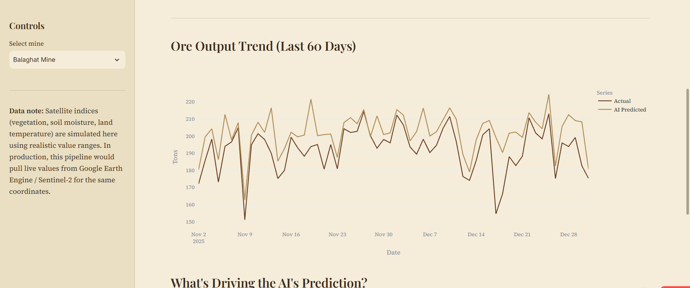
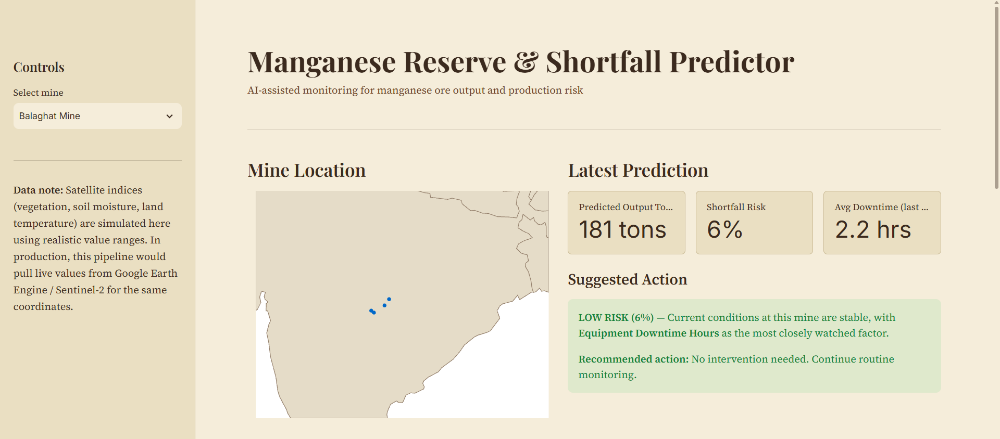

# Bhoomitra: Manganese Reserve & Shortfall Predictor

[One or two lines in your own words: what problem it solves and what it does.]

**Live demo:** [your Streamlit link]

## What it does
- Predicts daily manganese ore output (tons)
- Estimates shortfall risk as a percentage
- Suggests a corrective action based on the risk level
- Shows which factors drive each prediction

## How it works
[2-3 lines: the inputs, the two Random Forest models, the 80/20 split, 97.3% accuracy on held-out data.]

## Tech stack
Python, pandas, NumPy, scikit-learn, Streamlit, Plotly, joblib

## A note on the data
Mine locations are real MOIL sites (Balaghat, Nagpur, Ukwa, Gumgaon). Satellite indicators and operational values are simulated using realistic ranges, because real MOIL operational data needs official access.

## Run it locally
pip install -r requirements.txt
python generate_data.py
python train_model.py
streamlit run app.py

## What's next
- Live Sentinel-2 data via Google Earth Engine
- More geology-specific features
- Validation against real production records
